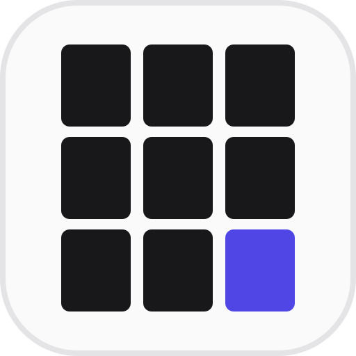
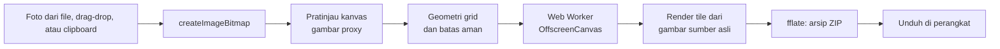

# PotongFeed

<p align="center">
  
</p>


[](LICENSE)

<p align="center">
  <strong>Satu foto. Feed Instagram yang nyambung.</strong><br />
  Pemotong foto grid Instagram open source yang berjalan 100% di browser.<br />
  Tanpa upload, tanpa login, tanpa watermark.
</p>

<!-- TODO: tambahkan screenshot atau GIF demo editor di sini, misalnya:
<p align="center"></p>
-->

PotongFeed memotong satu foto menjadi beberapa postingan yang menyatu rapi di grid profil Instagram. Atur posisi dan zoom, cek batas aman untuk wajah dan teks, lihat simulasinya di preview profil IG, lalu unduh potongan dalam urutan posting yang benar.

Semua pemrosesan gambar terjadi di perangkatmu. Foto tidak pernah dikirim ke server mana pun.

## Daftar isi

- [Kenapa PotongFeed?](#kenapa-potongfeed)
- [Fitur](#fitur)
- [Cara pakai](#cara-pakai)
- [Urutan upload dan batas aman](#urutan-upload-dan-batas-aman)
- [Cara kerja](#cara-kerja)
- [Memulai pengembangan](#memulai-pengembangan)
- [Deploy](#deploy)
- [Teknologi](#teknologi)
- [Struktur proyek](#struktur-proyek)
- [Perintah yang sering dipakai](#perintah-yang-sering-dipakai)
- [Batasan](#batasan)
- [Data dan privasi](#data-dan-privasi)
- [FAQ](#faq)
- [Kontribusi](#kontribusi)
- [Lisensi](#lisensi)

## Kenapa PotongFeed?

- **Privasi aman.** Pembacaan gambar, pemotongan, sampai pembuatan ZIP berjalan lokal di browser. Tidak ada backend, database, maupun API key.
- **Langsung pakai.** Buka editor, masukkan foto. Tanpa daftar akun, tanpa login, tanpa watermark.
- **Tahu aturan Instagram.** Rasio grid profil `3:4`, batas tepi yang terpotong, dan urutan upload sudah dihitung untukmu.
- **Hasil tajam.** Ekspor dirender dari gambar sumber asli, bukan dari pratinjau, dengan pilihan PNG, JPG, atau WebP.
- **Bisa offline.** Pada build produksi, aplikasi dapat dipasang sebagai PWA dan dibuka tanpa koneksi.
- **Open source.** Berlisensi MIT, mudah dipelajari, dan terbuka untuk kontribusi.

## Fitur

- **Grid dan rasio Instagram terbaru.** Mendukung rasio potongan `4:5` (otomatis diselaraskan agar sambungan tetap menyatu di grid profil `3:4`), `3:4` (penuh kotak profil), dan `1:1`. Tersedia preset cepat (`1×1`, `2×1`, `3×1`, `3×2`, `3×3`) maupun pengaturan bebas kolom dan baris.
- **Kanvas interaktif dengan snap magnet.** Masukkan foto lewat file picker, seret-lepas, atau tempel dari clipboard (`Ctrl+V`). Foto dapat digeser, di-zoom hingga `5×`, dipaskan ke tengah dengan snap otomatis, dan diatur dalam mode **Fill** atau **Fit** dengan latar putih, hitam, blur foto, atau warna pilihan.
- **Garis batas aman sebelum posting.** Tampilkan garis potong beserta nomor urut upload, tepi yang terpotong saat dilihat di profil IG, dan area aman hijau untuk menjaga wajah, logo, dan teks penting.
- **Preview profil Instagram interaktif.** Lihat simulasi langsung di profil IG `3:4` atau tampilan utuh yang menyambung, atur garis sela tipis dan info header profil, dan ketik langsung `@username` pada mockup profil.
- **Ekspor HD dengan format yang jelas.** Pilih **PNG** (lossless, cocok untuk desain dan teks), **JPG** kualitas tinggi (`95%–100%`) yang lebih ringan untuk upload Instagram, atau **WebP** sesuai dukungan browser. Pilih lebar standar Instagram **`1080 px`** atau **ukuran asli foto**, lalu unduh sebagai arsip `.zip` atau satuan, berurutan dari **#1**.
- **Tersimpan lokal dan siap dipasang.** Preferensi editor dan checklist status posting disimpan di `localStorage` perangkat. Pada build produksi, service worker menyimpan cache aset statis agar aplikasi bisa dipasang dan dibuka saat offline.

## Cara pakai

1. **Pilih foto.** Buka `/editor` lewat tombol **Potong foto sekarang**, lalu pilih file, seret ke kanvas, atau tempel dari clipboard. Format yang didukung: `JPG`, `PNG`, `WebP`, `AVIF`, dan `GIF`.
2. **Atur grid dan batas aman.** Tentukan jumlah kolom, baris, dan rasio (`4:5`, `3:4`, atau `1:1`). Atur posisi dan zoom foto, lalu periksa area aman dan simulasi profil IG.
3. **Unduh dan posting berurutan.** Pilih format **PNG** atau **JPG** beserta resolusinya, unduh arsip `.zip` atau potongan satuan, lalu upload ke Instagram mulai dari **#1** sampai selesai.

> Demo di halaman utama memakai ilustrasi contoh. PotongFeed tidak terhubung ke akun Instagram dan tidak memposting otomatis.

## Urutan upload dan batas aman

Instagram menampilkan postingan terbaru di kiri atas dan menggeser postingan lama ke kanan bawah. Karena itu PotongFeed menomori potongan mulai dari **#1 di kanan bawah** sampai kotak terakhir di kiri atas. Contoh untuk grid `3×2`:

```text
┌────┬────┬────┐
│ #6 │ #5 │ #4 │
├────┼────┼────┤
│ #3 │ #2 │ #1 │
└────┴────┴────┘
   ← upload #1 lebih dulu →
```

Checklist lokal di perangkat membantu menjaga urutan unggah supaya tidak tertukar.

**Batas aman**

- Pada rasio **4:5** dan **1:1**, ada sedikit tepi kiri-kanan yang hanya terlihat saat postingan dibuka satu per satu. Grid profil Instagram memotong setiap kotak ke proporsi **3:4**.
- Pada rasio **3:4**, ada sedikit tepi atas-bawah yang terpotong di beranda profil.
- Overlay **merah** menandai tepi yang terpotong, dan garis **hijau** menandai zona tengah yang aman untuk teks maupun wajah.

## Cara kerja

Pratinjau di kanvas memakai gambar proxy supaya tetap responsif pada foto beresolusi besar. Ekspor akhir selalu merender langsung dari gambar sumber asli, kotak demi kotak, untuk menjaga ketajaman dan penggunaan memori browser.



## Memulai pengembangan

### Prasyarat

- **Node.js 24** untuk runtime lokal dan build proyek.
- **pnpm 12.10.1** sesuai nilai `packageManager` di [package.json](package.json).

Tidak diperlukan backend, database, API key, maupun file `.env`.

### Instalasi

```bash
git clone https://github.com/fajri-farid/potongfeed.git
cd potongfeed
pnpm install --frozen-lockfile
```

### Jalankan mode pengembangan

```bash
pnpm dev
```

Buka **[http://localhost:3000](http://localhost:3000)**. Halaman utama ada di `/` dan editor di `/editor`.

### Build statis dan pratinjau produksi

```bash
pnpm build
pnpm dlx serve out
```

`pnpm build` menghasilkan situs statis di folder `out/` sesuai `output: "export"` di [next.config.ts](next.config.ts). Script [scripts/generate-sw-manifest.mjs](scripts/generate-sw-manifest.mjs) lalu memperbarui versi cache dan daftar aset `out/sw.js` secara otomatis. Buka alamat lokal yang dicetak `serve` untuk mencoba hasilnya.

> `pnpm start` (`next start`) tidak dipakai pada mode `output: "export"`.

## Deploy

Karena hasilnya situs statis, isi folder `out/` bisa di-host di layanan hosting statis mana pun. Pastikan:

- Situs dilayani lewat **HTTPS** pada **root domain** (`/`).
- Rute `/editor` dipetakan ke HTML hasil export.
- Request prefetch Next.js berjalan sesuai konfigurasi hosting tujuan.

## Teknologi

Badge di atas menampilkan versi dari `package.json` dan hasil instalasi proyek.

| Teknologi                                       | Digunakan untuk                                                     |
| ----------------------------------------------- | ------------------------------------------------------------------- |
| Next.js dan React                               | Halaman App Router, static export (`out/`), dan antarmuka aplikasi  |
| TypeScript                                      | Pemeriksaan tipe statis di seluruh kode sumber                      |
| Tailwind CSS                                    | Styling Light Mode dan tata letak responsif                         |
| HTML5 Canvas dan `OffscreenCanvas`              | Pratinjau komposisi dan pemotongan gambar tile demi tile di browser |
| Web Worker                                      | Menjalankan pemotongan resolusi tinggi tanpa membekukan UI          |
| `fflate`                                        | Mengemas potongan gambar ke arsip `.zip` di memori browser          |
| Service Worker dan Web Manifest                 | Caching aset statis untuk instalasi PWA dan mode offline            |
| Vitest, ESLint, Prettier, Husky, dan commitlint | Unit test, linting, formatting, dan validasi pesan commit           |

## Struktur proyek

| Folder               | Isi                                                                                             |
| -------------------- | ----------------------------------------------------------------------------------------------- |
| `src/app/`           | Halaman beranda (`/`), editor (`/editor`), layout root, dan CSS global                          |
| `src/components/`    | Header, dropzone upload, kanvas editor, kontrol grid, garis bantu, preview IG, dan panel ekspor |
| `src/lib/`           | Geometri grid, pembacaan gambar lokal, renderer tile, pipeline ekspor ZIP, dan `localStorage`   |
| `src/lib/__tests__/` | Unit test Vitest untuk geometri, loader gambar, renderer tile, ekspor, dan penyimpanan lokal    |
| `src/workers/`       | Web Worker `splitter.worker.ts` untuk pemotongan gambar di sisi klien                           |
| `src/types/`         | Definisi tipe TypeScript editor                                                                 |
| `public/`            | Ikon aplikasi/PWA, ilustrasi demo, `manifest.webmanifest`, dan service worker `sw.js`           |
| `scripts/`           | `generate-sw-manifest.mjs` untuk memperbarui daftar precache di `out/sw.js`                     |

## Perintah yang sering dipakai

| Perintah            | Kegunaan                                                                  |
| ------------------- | ------------------------------------------------------------------------- |
| `pnpm dev`          | Menjalankan server pengembangan Next.js                                   |
| `pnpm lint`         | Memeriksa aturan ESLint                                                   |
| `pnpm typecheck`    | Memeriksa tipe TypeScript dengan `tsc --noEmit`                           |
| `pnpm format`       | Merapikan format file dengan Prettier                                     |
| `pnpm format:check` | Memeriksa kepatuhan format Prettier                                       |
| `pnpm test`         | Menjalankan seluruh unit test Vitest sekali jalan                         |
| `pnpm test:watch`   | Menjalankan unit test dalam mode watch                                    |
| `pnpm build`        | Membangun static export `out/` dan menjalankan `postbuild` service worker |

## Batasan

- Satu sesi mendukung hingga **3 kolom × 6 baris (18 postingan)**.
- Rendering per tile dibatasi maksimal **8.192 px** per sisi dan **16 juta piksel** per tile agar stabil di browser mobile maupun Safari.
- Untuk foto sumber di atas **40 MP**, editor menampilkan pengingat.
- Kualitas dan kelancaran pemrosesan sangat bergantung pada limit memori dan dukungan format di browser serta perangkat pengguna.

## Data dan privasi

- Pembacaan gambar, pembuatan pratinjau, pemotongan tile, hingga pembuatan arsip `.zip` berjalan lokal di browser memakai API standar (`createImageBitmap`, `<canvas>`, `OffscreenCanvas`, dan `fflate`). **Tidak ada upload foto ke server.**
- Saat online, browser tetap melakukan request HTTP ke host statis untuk memuat halaman, skrip, style, font, dan aset aplikasi.
- Preferensi (`potongfeed:v4:preferences`) dan checklist upload (`potongfeed:v1:upload-checklist`) disimpan di `localStorage` perangkat dan bertahan selama data situs browser tidak dihapus.
- Service worker hanya didaftarkan pada build produksi lewat HTTPS (atau `localhost`) di browser yang mendukungnya. Untuk menguji mode offline, buka build produksi saat online sampai aset selesai di-cache, lalu matikan koneksi.

## FAQ

**Apakah foto saya diunggah ke server?**
Tidak. Seluruh proses berjalan di browser. Kamu bisa memverifikasinya lewat tab Network di DevTools atau langsung membaca kodenya.

**Kenapa nomor #1 ada di kanan bawah?**
Instagram menaruh postingan terbaru di kiri atas. Supaya grid tersusun benar, potongan harus diunggah dari kanan bawah ke kiri atas.

**Apakah PotongFeed memposting otomatis ke Instagram?**
Tidak. PotongFeed tidak terhubung ke akun Instagram. Kamu mengunduh hasilnya lalu mengunggahnya sendiri.

**Mana yang sebaiknya dipilih, PNG atau JPG?**
PNG untuk desain dan teks yang butuh hasil lossless. JPG kualitas tinggi (`95%–100%`) lebih ringan dan cocok untuk upload Instagram.

**Bisa dipakai tanpa internet?**
Bisa, pada build produksi. Buka sekali saat online sampai aset ter-cache, lalu aplikasi dapat dibuka offline.

## Kontribusi

Kontribusi sangat disambut, mulai dari laporan bug, usulan fitur, sampai pull request.

**Melaporkan bug atau mengusulkan fitur**
Buat issue di [GitHub Issues](https://github.com/fajri-farid/potongfeed/issues) dan sertakan langkah reproduksi, browser atau perangkat, hasil yang diharapkan, serta hasil aktual. Gunakan gambar contoh yang aman dibagikan tanpa data pribadi.

**Mengirim perubahan kode**

1. Fork repository, lalu buat branch terpisah.
2. Buat perubahan dan tambahkan atau perbarui test bila perlu.
3. Pastikan semua pemeriksaan berikut lulus:

   ```bash
   pnpm typecheck
   pnpm lint
   pnpm format:check
   pnpm test
   pnpm build
   ```

4. Ajukan pull request yang menjelaskan perubahan dan hasil pengujiannya.

**Prinsip proyek**

- Pemrosesan gambar harus tetap **100% client-side**.
- Kompatibilitas **static export** (`out/`) harus terjaga.
- Pesan commit mengikuti **Conventional Commits Bahasa Indonesia** sesuai [commitlint.config.mjs](commitlint.config.mjs) dan hook Husky.

## Lisensi

Dirilis di bawah [lisensi MIT](LICENSE). Kamu bebas menggunakan, mengubah, dan mendistribusikan kodenya dengan tetap menyertakan pemberitahuan hak cipta dan izin lisensi. Dependency dan aset pihak ketiga tetap tunduk pada lisensinya masing-masing.

PotongFeed adalah proyek independen dan tidak berafiliasi dengan Instagram maupun Meta.
